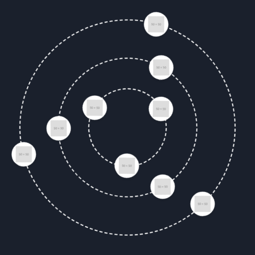

# latibro-core &#x1F30C;

Latibro (read backwards) is a lightweight JavaScript library for creating animated orbital elements.



## Features

- Dynamic circular orbit with items animations.
- Supports multiple orbits with independent speeds.
- Interactive items with panel display on click **<code>v0.4.0</code>**.
- Fully customizable:
  - Container, Orbit and Item customization (default CSS, custom CSS classes, inline styles).
  - Panel global and per-item customization (position/dimension and custom CSS classes) **<code>v0.4.0</code>**
  - Orbit styles (color, thickness, etc.).
  - Element animations and spacing.
- Designed for performance and ease of use.

## Installation

```bash
npm install latibro-core
```

## Configuration

### Important Update in <code>v0.4.0</code>

### Breaking Changes

- Renamed all `styles` properties to `style` (singular)
  - Migration: Change `something.styles` to `something.style`

### New Features

- Added interactive items with panel display functionality
- New configuration options for panels and interactivity
- Improved animation handling

See [CHANGELOG.md](./CHANGELOG.md) for more details.

## New Features Documentation <code>v0.4.0</code>

### Interactivity Configuration <code>v0.4.0</code>

Enable interactivity for items with content panels:

```javascript
const config = {
  interactivity: {
    enabled: true, // Enable interactivity
    mouseLeaveDelay: 300, // Delay before animation resumes after mouse leave (ms)
  },
  panel: {
    backdrop: true, // Close panel when clicking outside
    position: "center", // Panel position (top, bottom, left, right, center)
    dimension: {
      // Panel dimensions (responsive to the viewport dimension)
      width: "80%",
      height: "60%",
    },
    close: {
      // Close button configuration
      label: "×", // Close button text
      title: "Close panel", // Close button title
    },
  },
  orbits: [
    {
      items: [
        {
          src: "https://placehold.co/50",
          panel: {
            content: "<h2>Item Content</h2><p>This appears inside the panel</p>",
            position: "top right", // Override global panel position
          },
        },
      ],
    },
  ],
};
```

### Panel Configuration Options <code>v0.4.0</code>

| Property                        | Type    | Default                       | Description                                                        |
| ------------------------------- | ------- | ----------------------------- | ------------------------------------------------------------------ |
| `interactivity.enabled`         | Boolean | `false`                       | Enable or disable item interactivity                               |
| `interactivity.mouseLeaveDelay` | Number  | `0`                           | Delay before animation resumes after mouse leave (ms)              |
| `panel.backdrop`                | Boolean | `true`                        | Close panel when clicking outside                                  |
| `panel.position`                | String  | `"center center"`             | Panel position (top, bottom, left, right, center, or combinations) |
| `panel.dimension.width`         | String  | `"100%"`                      | Panel width                                                        |
| `panel.dimension.height`        | String  | `"100%"`                      | Panel height                                                       |
| `panel.close.label`             | String  | `"×"`                         | Close button text                                                  |
| `panel.close.title`             | String  | `"Click to close this panel"` | Close button title                                                 |

### Item Panel Configuration <code>v0.4.0</code>

Each item can define its own panel content and override global settings:

```javascript

{
  src: "image.jpg", // the displayed panel content when it is closed
  panel: {
    content: "<div>Custom HTML content</div>", // the displayed panel content when it is opened
    position: "top right", // Override global panel position
    dimension: { // Override global panel dimension
      width: "300px",
      height: "200px"
    }
  }
}

```

### Animation Customization <code>v0.4.0</code>

```javascript
animation: {
  borderRadius: {
    // panel border radius settings (the transition between 'from' and 'to' is animated)
    from: "50%", // when panel is closed (full rounded circle)
    to: "4px" // when panel is opened (small border radius)
  },
  moving: { // when panel is moving from/to its initial/final position
    duration: 400
  },
  opening: { // when panel is scaling up
    duration: 800
  },
  closing: { // when panel is scaling down
    duration: 800
  }
}
```

### Examples

#### **Basic Interactive Example** <code>v0.4.0</code>

```javascript
import Orbital from "latibro-core";

const config = {
  interactivity: {
    enabled: true,
  },
  orbits: [
    {
      items: [
        {
          src: "https://placehold.co/50",
          panel: {
            content: "<h2>Item 1</h2><p>Content for item 1</p>",
          },
        },
        {
          src: "https://placehold.co/50",
          panel: {
            content: "<h2>Item 2</h2><p>Content for item 2</p>",
          },
        },
      ],
    },
  ],
};

const container = document.getElementById("orbital-container");
new Orbital(container, config);
```

#### Advanced Panel Configuration <code>v0.4.0</code>

**Notes**: By design, the panel object has no inline style configuration. Please use `panel.customCss` instead.

```javascript
const config = {
  interactivity: {
    enabled: true,
    mouseLeaveDelay: 500, // When the mouse leaves the item, wait 500ms before resuming animation.
  },
  panel: {
    position: "top right",
    dimension: {
      width: "400px",
      height: "300px",
    },
    close: {
      label: "Close",
      title: "Click to close",
    },
  },
  orbits: [
    {
      items: [
        {
          src: "icon.png",
          panel: {
            content: "<div>...</div>",
            customCss: "special-panel",
          },
        },
      ],
    },
  ],
};
```

#### **Basic Example**

<code>index.html</code>

```html
<!DOCTYPE html>
<html lang="en">
  <head>
    <meta charset="UTF-8" />
    <meta name="viewport" content="width=device-width, initial-scale=1.0" />
    <title>Basic Example</title>
    <script type="module" src="./config.js"></script>
  </head>

  <body>
    <div id="orbital-container"></div>
  </body>
</html>
```

<code>src/config.js</code>

```javascript
import Orbital from "latibro-core";

const config = {
  orbits: [
    {
      items: ["https://placehold.co/50", "https://placehold.co/50"],
      style: {
        borderColor: "red",
        borderWidth: "2px",
        borderStyle: "solid",
      },
      speed: 10,
    },
  ],
};

const container = document.getElementById("orbital-container");
new Orbital(container, config);
```

#### **Example: Default CSS rules**

<code>.orbital-container</code>

```css
.orbital-container {
  width: 500px;
  height: 500px;
  position: relative;
  overflow: hidden;
  display: flex;
  align-items: center;
  justify-content: center;
  background-color: #1a202c;
}
```

### Customization Order (CSS Priority)

The styles applied to both the container and orbits follow a specific order of priority:

1. **Default CSS** rules (built-in styles applied automatically).
2. **Custom CSS** (<code>customCss</code>) (if defined, these class styles override the defaults).
3. **Inline styles** (<code>style</code>) (if defined, these will override both default and custom CSS styles).

## Container Customization

The <code>container</code> configuration allows you to customize the **main orbit container** using **CSS classes** or **inline styles**.

| Prop                   | Type                | Default         | Description                                  |
| ---------------------- | ------------------- | --------------- | -------------------------------------------- |
| <code>customCss</code> | <code>String</code> | <code>""</code> | Custom CSS classes applied to the container. |
| <code>style</code>     | <code>Object</code> | <code>{}</code> | Inline styles applied to the container .     |

## Examples

#### **Example: Using Custom CSS**

```javascript
const config = {
  container: {
    customCss: "custom-container",
  },
};
```

#### **Example: Using Inline Styles**

```javascript
const config = {
  container: {
    style: {
      width: "500px",
      height: "500px",
      backgroundColor: "#ff5733",
    },
  },
};
```

## Orbit Customization

Each orbit can be customized in the same way as the container, using:

1. **Default CSS** rules (applied automatically to all orbits).
2. **Custom CSS** (<code>customCss</code>) (if provided, this class is added on top of the default styles).
3. **Inline styles** (<code>style</code>) (applied last and override all previous styles).

### Orbits Global Properties

| Prop                      | Type                | Default         | Description                                                          |
| ------------------------- | ------------------- | --------------- | -------------------------------------------------------------------- |
| <code>orbits</code>       | <code>Array</code>  | <code>[]</code> | List of orbit objects. Each orbit defines items and styling options. |
| <code>orbitSpacing</code> | <code>Number</code> | <code>55</code> | The spacing (value) between consecutive orbits.                      |

#### **Example: Custom Orbits spacing**

```javascript
const config = {
  orbits: [
    {
      items: ["https://placehold.co/50"],
    },
    {
      items: ["https://placehold.co/50"],
    },
    {
      items: ["https://placehold.co/50"],
    },
  ],
  orbitSpacing: 200,
};
```

### Orbit <code>Object</code> Properties

| Prop                      | Type                | Default           | Description                                                  |
| ------------------------- | ------------------- | ----------------- | ------------------------------------------------------------ |
| <code>items</code>        | <code>Array</code>  | <code>[]</code>   | Array of image URLs or content to display as orbiting items. |
| <code>customRadius</code> | <code>Number</code> | <code>75</code>   | Custom radius (value) for the orbit.                         |
| <code>customCss</code>    | <code>String</code> | <code>null</code> | Custom CSS classes to apply to the orbit element.            |
| <code>style</code>        | <code>Object</code> | <code>{}</code>   | Inline styles (applied last, override everything).           |
| <code>speed</code>        | <code>Number</code> | <code>10</code>   | Speed of rotation (in seconds for one full rotation).        |

## Examples

#### **Example: Custom CSS for Orbits**

```javascript
const config = {
  orbits: [
    {
      items: ["https://placehold.co/50"],
      customCss: "custom-orbit",
    },
  ],
};
```

#### **Example: Custom Inline Styles for Orbits**

```javascript
const config = {
  orbits: [
    {
      items: ["https://placehold.co/50"],
      style: {
        border: "3px solid red",
        width: "200px",
        height: "200px",
      },
    },
  ],
};
```

#### **Example: Default CSS rules**

<code>.orbit-0</code>

```css
.orbit-0 {
  position: absolute;
  width: 150px;
  height: 150px;
  border-radius: 50%;
  border: 2px dashed white;
  animation: 10s linear 0s infinite normal none running orbit-0-rotation;
}
```

Built-in CSS class (<code>.orbit-<0..n></code>) are applied automatically for each orbit.
Some CSS props like <code>width</code>, <code>height</code> or <code>animation</code> are automatically calculated, based on the number of generated orbits.

## Items Customization

Each item (attached to orbit) can be customized in the same way as the container, using:

1. **Default CSS** rules (applied automatically to all items).
2. **Custom CSS** (<code>customCss</code>) (if provided, this class is added on top of the default styles).
3. **Inline styles** (<code>style</code>) (applied last and override all previous styles).

### Item <code>Object</code> Properties

Each item inside an orbit can be configured using either a **string** (image URL) or an **object** with more customization options.

| Prop        | Type     | Default | Description                                        |
| ----------- | -------- | ------- | -------------------------------------------------- |
| `src`       | `string` | `""`    | Image URL of the orbiting item.                    |
| `customCss` | `string` | `null`  | Custom CSS classes applied to the item.            |
| `style`     | `Object` | `{}`    | Inline styles (applied last, override everything). |

## Examples

#### **Example: Using Image URLs (string array)**

```javascript
const config = {
  orbits: [
    {
      items: ["https://placehold.co/50", "https://placehold.co/50"],
    },
  ],
};
```

#### **Example: Using Custom Item Objects**

```javascript
const config = {
  orbits: [
    {
      items: [
        {
          src: "https://placehold.co/50",
          customCss: "custom-item",
          style: {
            border: "2px solid red",
            width: "40px",
            height: "40px",
          },
        },
      ],
    },
  ],
};
```

#### Example: Default HTML structure

```html
<div id="orbital-container" class="orbital-container">
  <div class="orbit orbit-0">
    <div class="orbit-wrapper orbit-wrapper-0-0">
      <div class="orbit-item orbit-item-0-0">
        
      </div>
    </div>
  </div>
</div>
```

Check the <code>/examples/</code> folder for various running demos and configurations:

- Basic (<code>basic/</code>). Simple orbit with default parameters.
- Container CSS (<code>container-css/</code>). Example showing how to style the container.
- Orbit CSS (<code>orbit-css/</code>). Example showing how to style orbits.
- Multiple Orbits (<code>multi-orbits/</code>). Example with independent configurations.
- Interactivity (<code>interactivity/</code>). Example with items having interactivity enabled.

## Development

Run the development server:

```bash
npm run dev
```

Build the library for production:

```bash
npm run build
```

## License

This project is licensed under the [MIT License](https://github.com/hramasimpaniry/latibro-core/blob/main/LICENSE).

---
